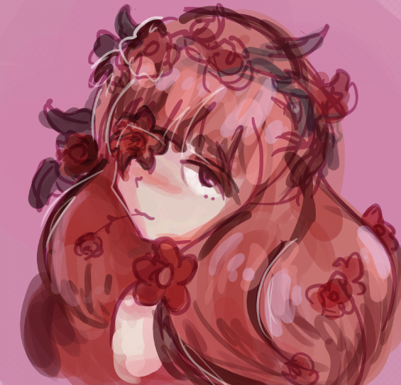

# Hanami osu!

Tools, games, and services for the osu! community, built in the open.

[Website](https://hanami.yorunoken.com) · [Community](https://discord.gg/RcGjBZkDP6) · [Sponsor yorunoken](https://github.com/sponsors/yorunoken) · [Issues & planning](https://github.com/hanami-osu/infra/issues)

## Projects

| Project | What it is |
| --- | --- |
| [Hanami Bot](https://github.com/hanami-osu/bot) | Discord bot for osu! stats, tracking, and utilities |
| [osu!guessr](https://github.com/hanami-osu/osu-guessr) | Guess the beatmap from audio, images, and skins, played in the browser. Live at [osuguessr.com](https://osuguessr.com) |
| [Hanami Web](https://github.com/hanami-osu/web) | Public website and shared account platform. Handles Bot account linking and osu!guessr sign-in. Accounts are still in development |
| [Hanami Companion](https://github.com/hanami-osu/companion) | Desktop app connecting osu! and local system features. In development |

## Where to file things

Bugs and feature requests go to the repository that owns the behavior. Shared infrastructure, account systems, cross-project integrations, or work without an obvious home belongs in [hanami-osu/infra](https://github.com/hanami-osu/infra/issues).

Before opening anything larger, skim the [contributing guide](../CONTRIBUTING.md). Found an exploit or credential leak? Follow the [security policy](../SECURITY.md) instead of filing publicly.

---

Hanami is an independent community project and is not affiliated with or endorsed by osu! or ppy Pty Ltd.
